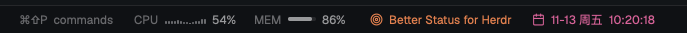

# Better Status for Herdr

[中文](README.zh-CN.md)

A quieter status bar for [Herdr](https://herdr.dev): CPU and memory, one line of your own, and the date and time.



- **CPU and memory**, every 2 seconds (macOS, Linux)
- **Your one thing**: click to edit, pick a color
- **Date and time** with seconds; click to pick a color
- Herdr's machine, branch and agents stay on the left

## Install for agent

Paste this to your agent in Herdr:

```text
Install the Herdr mod at https://github.com/Umupa/herdr-better-status:
copy mods/better-status into ~/.config/herdr-app/mods/, run herdr-app check on it,
and point my layout's status block at "better-status".
```

## Install by hand

```sh
git clone https://github.com/Umupa/herdr-better-status.git
cp -R herdr-better-status/mods/better-status ~/.config/herdr-app/mods/
```

In your layout, set the status block's mod:

```json
{ "id": "status", "type": "block", "size": { "px": 28 }, "content": { "mod": "better-status" } }
```

## Notes

Runs `ps`, `sysctl`, `vm_stat` (macOS) or reads `/proc` (Linux). No network. Apache-2.0, see [NOTICE](NOTICE).
