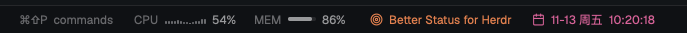

# Better Status for Herdr

[English](README.md)

更安静的 [Herdr](https://herdr.dev) 状态栏：CPU 和内存、一句你自己的话、日期和时间。



- **CPU 和内存**，每 2 秒刷新（macOS、Linux）
- **你的一件事**：点击编辑，可选颜色
- **日期和时间**，带秒；点击可选颜色
- Herdr 自带的机器、分支、agent 数量仍在左边

## 让 agent 安装

把这段发给 Herdr 里的 agent：

```text
安装 Herdr mod https://github.com/Umupa/herdr-better-status：
把 mods/better-status 复制到 ~/.config/herdr-app/mods/，用 herdr-app check 检查，
再把我布局里状态栏那一块的 mod 改成 "better-status"。
```

## 手动安装

```sh
git clone https://github.com/Umupa/herdr-better-status.git
cp -R herdr-better-status/mods/better-status ~/.config/herdr-app/mods/
```

在布局里把状态栏那一块改成：

```json
{ "id": "status", "type": "block", "size": { "px": 28 }, "content": { "mod": "better-status" } }
```

## 说明

会运行 `ps`、`sysctl`、`vm_stat`（macOS）或读取 `/proc`（Linux），不联网。Apache-2.0，见 [NOTICE](NOTICE)。
