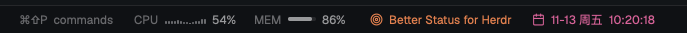

# Better Status

Herdr's status bar with CPU and memory, one line of your own (One Thing style), and the date and time, on the right; Herdr's machine, branch and agent count stay on the left.

**What you see:**

- One 28px row, `t.chrome` background, top border, 11.8px text. Left (`t.muted`): machine, branch, agent count, unchanged from Herdr's `workspace-status`. A flexible gap. Right, 20px apart: the palette hint (`t.dim`); `CPU` with 14 bars (2px wide, 1px apart, up to 10px tall, `t.dim`) and a percentage; `MEM` with a 28×4px meter (`t.border` track, `t.muted` fill) and a percentage; a 13px Lucide `target` and your line; a 13px Lucide `calendar`, `MM-DD 周X` and `HH:MM:SS` in a fixed 64px box that cannot shrink or wrap, so wide digit pairs stay on one line and the row doesn't shift each second.
- Labels are `t.dim`, values `t.muted`. Your line and the date default to `t.muted`; each can instead be one of `#8b7cf6 #5b8def #22b8cf #3fae6a #e3a73f #e3814f #e5604d #d9649a`. With no line: a `t.dim` "One thing".

**How it behaves:**

- Click your line: it becomes a 300px input (accent border) with 9 color dots (12px, the chosen one ringed in `t.foreground`; the first is the theme gray). Enter saves, Esc cancels, clicking away saves 200ms after the input loses focus unless a dot took it back.
- Click the date: the same dots appear to its left; a pick applies and closes them; clicking the date again closes them.
- The clock redraws each second. CPU and memory are sampled every 2 seconds: macOS `ps -A -o %cpu=` summed / `hw.ncpu`, memory (anonymous − purgeable + wired + compressor pages) / `hw.memsize` from `vm_stat`; Linux `/proc/stat` deltas and `MemAvailable`/`MemTotal`. Elsewhere the meters are hidden.
- Shared keys: `better-status.phrase`, `better-status.color`, `better-status.clockColor`.

**Built from:**

- `mods/better-status/main.js`, herdr-app 0.1.15 `defaults/mods/workspace-status/main.js` with changes marked `better-status`; `icons/calendar.svg`, `icons/target.svg` (Lucide).
- herdr: `spaces`, `agents`, `theme`, `run`, `window`, `keys`, `shared`/`setShared`, `exec`. gpui-base `InputState`/`Input`.

**Watch out:**

- `truncate()` measured the line as zero wide in this row; long lines are cut to 60 characters in code instead.
- `"transparent"` is not a color; use `#00000000`.

**Done when:**

- The date and time tick every second and nothing to their left moves.
- Clicking the line edits it in place; a color dot recolors it without closing the input; the line survives a restart.
- CPU and MEM show plausible numbers on macOS and Linux.
- `herdr-app check ~/.config/herdr-app/mods/better-status` passes.
